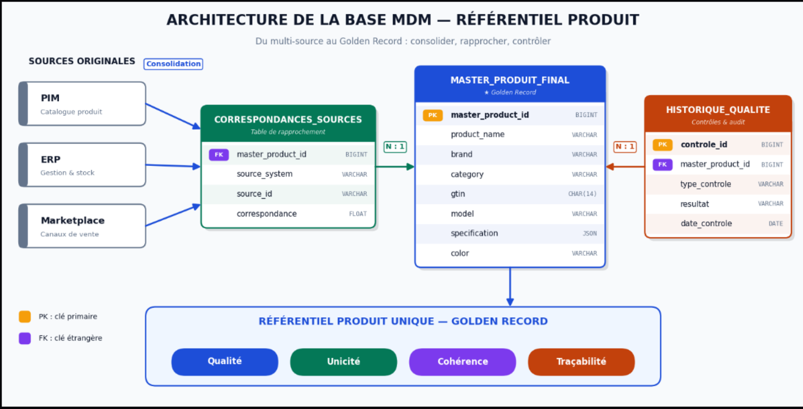
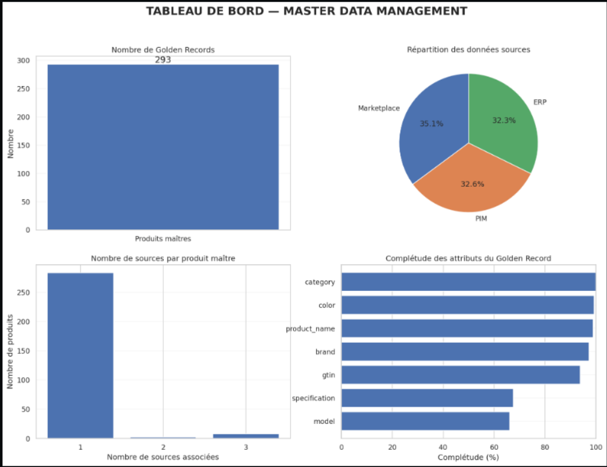
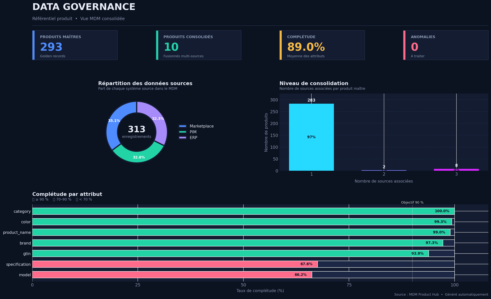
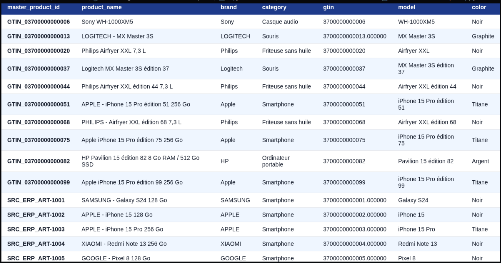

# Data Governance & Master Data Management (MDM)

**Conception et mise en place d'un référentiel produit unifié à partir de données hétérogènes.**

## Présentation du projet

Dans un système d'information, les informations relatives aux produits peuvent être dispersées dans plusieurs applications. Chaque application possède sa propre structure, ses propres identifiants et ses propres conventions de nommage.

Cette fragmentation peut entraîner des problèmes de qualité des données : doublons, incohérences, informations manquantes et difficultés de rapprochement.

Ce projet consiste à concevoir une démarche de **Data Governance et de Master Data Management (MDM)** permettant de consolider les données produits issues de trois systèmes différents : PIM, ERP et Marketplace.

L'objectif final est de construire un **référentiel produit unique (Golden Record)**, cohérent, fiable et traçable.

## Problématique

Comment mettre en place une gouvernance des données permettant de consolider les informations produits issues de trois applications hétérogènes (PIM, ERP et Marketplace), afin de construire un référentiel produit unique, fiable et cohérent, tout en garantissant la qualité, la traçabilité et la maîtrise des données maîtres ?

## Objectifs

- Diagnostiquer la qualité des données provenant des différentes sources.
- Identifier les problèmes de complétude, d'unicité et de cohérence.
- Harmoniser les structures et les attributs des différentes sources.
- Normaliser les données textuelles et les identifiants produits.
- Mettre en place des mécanismes de rapprochement (*Record Linkage*).
- Construire un référentiel produit centralisé.
- Définir des règles métier et des contrôles de qualité.
- Assurer la traçabilité des correspondances entre les sources et le référentiel maître.

## Architecture des données

Le projet repose sur trois sources de données fictives :

| Source | Description | Identifiant |
|---|---|---|
| PIM | Gestion des informations produits | `product_id` |
| ERP | Gestion des articles et informations internes | `article_id` |
| Marketplace | Gestion des offres des vendeurs | `offer_id` |

Les trois sources contiennent des attributs similaires, mais leurs noms de colonnes et leurs formats sont différents.
## Architecture MDM



### Architecture cible

```text
       PIM          ERP        Marketplace
        |            |              |
        +------------+--------------+
                     |
                     v
             Diagnostic des données
                     |
                     v
              Harmonisation
                     |
                     v
          Normalisation des données
                     |
                     v
          Matching / Record Linkage
                     |
                     v
              Consolidation
                     |
                     v
             GOLDEN RECORD
                     |
          +----------+----------+
          |                     |
          v                     v
  Référentiel produit    Correspondances
       maître              des sources
```

## Démarche de réalisation

### 1. Diagnostic des données

Analyse exploratoire des trois sources afin d'évaluer leur qualité.

Contrôles réalisés :
- Complétude des attributs obligatoires.
- Unicité des identifiants.
- Détection des doublons.
- Vérification du format des GTIN.
- Contrôle des valeurs numériques.
- Identification des incohérences potentielles.

## Diagnostic des données



### 2. Harmonisation des données

Création d'une structure commune permettant de représenter les informations des trois systèmes.

Exemple de correspondance :

| Attribut harmonisé | PIM | ERP | Marketplace |
|---|---|---|---|
| product_name | product_name | libelle_article | titre_annonce |
| brand | brand | marque | brand_name |
| category | category | famille_article | category_name |
| gtin | gtin | code_barres | barcode |
| model | model | modele | — |
| specification | specification | caracteristique | variant |
| color | color | couleur | color_name |

### 3. Normalisation

Application de traitements pour améliorer la comparabilité des données :

- Normalisation des chaînes de caractères.
- Suppression des espaces superflus.
- Uniformisation de la casse.
- Gestion des caractères spéciaux et des accents.
- Nettoyage et validation du format des GTIN.

Le GTIN (*Global Trade Item Number*) est un identifiant international utilisé pour identifier les articles commerciaux. Il constitue un attribut important pour le rapprochement des produits.

### 4. Matching et rapprochement des enregistrements

Le rapprochement des données vise à identifier les enregistrements qui représentent potentiellement le même produit dans plusieurs systèmes.

Les identifiants internes sont conservés afin d'assurer la traçabilité.

Le GTIN peut servir de clé de rapprochement lorsqu'il est valide. Les autres attributs produits permettent de compléter et de vérifier les correspondances.

Le fichier de correspondances fourni avec le jeu de données est réservé à l'évaluation des résultats du rapprochement.

## Dashboard de gouvernance



### 5. Construction du référentiel maître

La consolidation permet de construire un référentiel produit centralisé, appelé **Golden Record**.

La sélection des valeurs repose sur des règles de survivorship et sur la priorité accordée aux sources.

Le référentiel maître contient les informations communes et consolidées des produits, tandis que les informations propres aux vendeurs, les prix et les stocks restent associées aux sources correspondantes.

## Modèle de données MDM

Le modèle cible s'organise autour de trois tables :

| Table | Rôle |
|---|---|
| `master_produit_final` | Stockage des Golden Records |
| `correspondances_sources` | Traçabilité des enregistrements sources associés aux produits maîtres |
| `historique_qualite` | Historisation des contrôles de qualité (extension cible) |

### Exemple de structure du Golden Record

| Attribut | Description |
|---|---|
| master_product_id | Identifiant unique du produit maître |
| product_name | Nom du produit |
| brand | Marque |
| category | Catégorie |
| gtin | Identifiant commercial |
| model | Modèle |
| specification | Caractéristiques |
| color | Couleur |

## Référentiel produit maître



## Gouvernance et qualité des données

La gouvernance s'appuie sur des règles métier visant à garantir la fiabilité du référentiel.

Exemples de règles :

- **RM01 :** Chaque produit maître doit posséder un identifiant unique.
- **RM02 :** Les attributs obligatoires doivent être renseignés.
- **RM03 :** Les GTIN doivent respecter un format reconnu.
- **RM04 :** Les identifiants sources doivent être conservés.
- **RM05 :** Les correspondances doivent être traçables.
- **RM06 :** Les prix et les stocks ne doivent pas être intégrés aux attributs communs du Golden Record.

### Rôles de gouvernance

| Rôle | Responsabilité |
|---|---|
| Data Owner | Responsable métier des données produits |
| Data Steward | Contrôle de la qualité et des règles métier |
| Data Engineer | Intégration, transformation et consolidation |
| Data Consumer | Utilisation du référentiel produit |

## Technologies utilisées

- **Python** : traitement et transformation des données.
- **Pandas** : manipulation et harmonisation des données.
- **NumPy** : opérations numériques.
- **Matplotlib / Seaborn** : visualisation et diagnostic.
- **Jupyter Notebook** : exploration, expérimentation et documentation.
- **CSV** : stockage et échange des données.

## Structure du projet

```text
Data-Governance-MDM/
│
├── data/
│   ├── raw/
│   │   ├── 01_PIM_catalogue_produits.csv
│   │   ├── 02_ERP_articles.csv
│   │   ├── 03_Marketplace_offres_vendeurs.csv
│   │   └── 04_correspondances_evaluation.csv
│   │
│   └── processed/
│
├── notebooks/
│   └── 01_diagnostic_donnees.ipynb
│
├── src/
│
├── reports/
│
├── README.md
├── pyproject.toml
└── .gitignore
```

## Installation et exécution

### 1. Cloner le projet

```bash
git clone https://github.com/Ramadiaw12/Project_datagouvernance.git
cd Data-Governance-MDM
```

### 2. Créer un environnement virtuel

Avec UV :

```bash
uv venv
source .venv/bin/activate
```

### 3. Installer les dépendances

```bash
uv pip install -r requirements.txt
```

### 4. Lancer Jupyter Notebook

```bash
jupyter notebook
```

Ouvrir ensuite :

```text
notebooks/01_diagnostic_donnees.ipynb
```

Exécuter les cellules dans l'ordre pour reproduire les analyses et les traitements.

## Résultats attendus

Le projet vise à produire :

- Un diagnostic de qualité des données des trois sources.
- Des données harmonisées et normalisées.
- Des correspondances entre les enregistrements sources.
- Un référentiel produit maître (Golden Record).
- Un dictionnaire de données.
- Des règles métier de gouvernance.
- Des indicateurs et visualisations de qualité.

## Limites et perspectives

Plusieurs améliorations peuvent être envisagées :

- Implémenter un rapprochement probabiliste avancé avec des méthodes de Record Linkage.
- Évaluer la précision et le rappel des correspondances à partir du fichier de vérité terrain.
- Ajouter une gestion des conflits entre les attributs sources.
- Mettre en place un historique des modifications du référentiel.
- Migrer le référentiel vers une base de données relationnelle comme PostgreSQL.
- Intégrer une solution de Data Catalog et de gouvernance comme OpenMetadata.

## Conclusion

Ce projet illustre l'importance de la gouvernance des données dans un environnement où plusieurs applications produisent et maintiennent des informations sur les mêmes produits.

À travers le diagnostic, l'harmonisation, la normalisation, le rapprochement et la consolidation, l'objectif est de passer de données dispersées et hétérogènes à un référentiel produit centralisé et maîtrisé.

**Le MDM constitue ainsi un levier essentiel pour améliorer la qualité, la cohérence et la traçabilité des données au sein du système d'information.**
